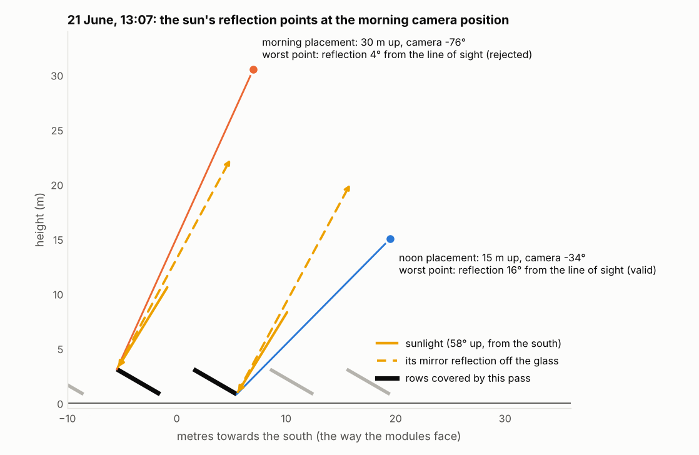
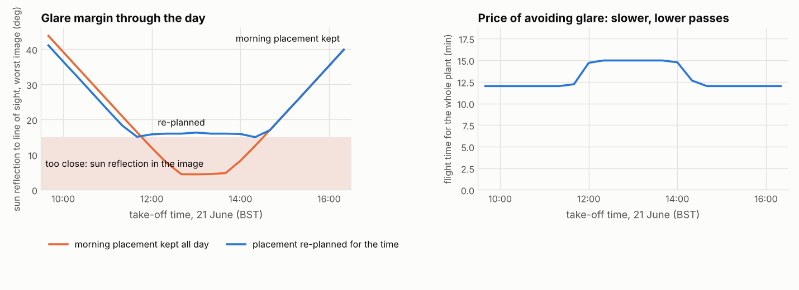
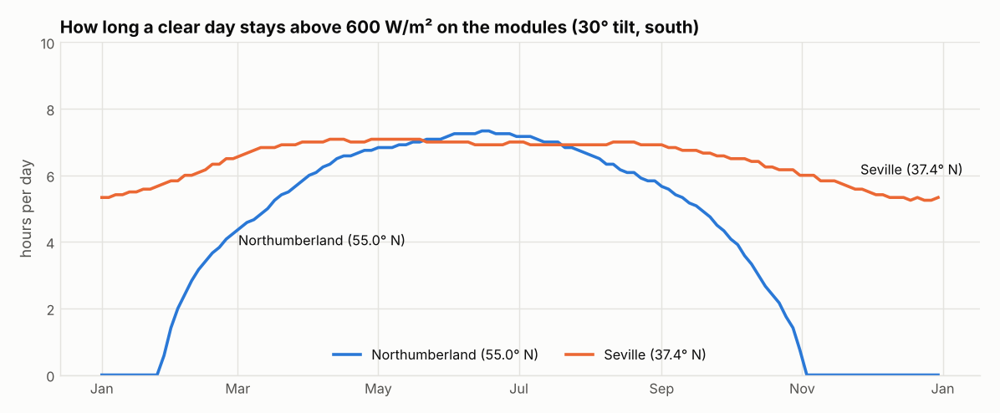
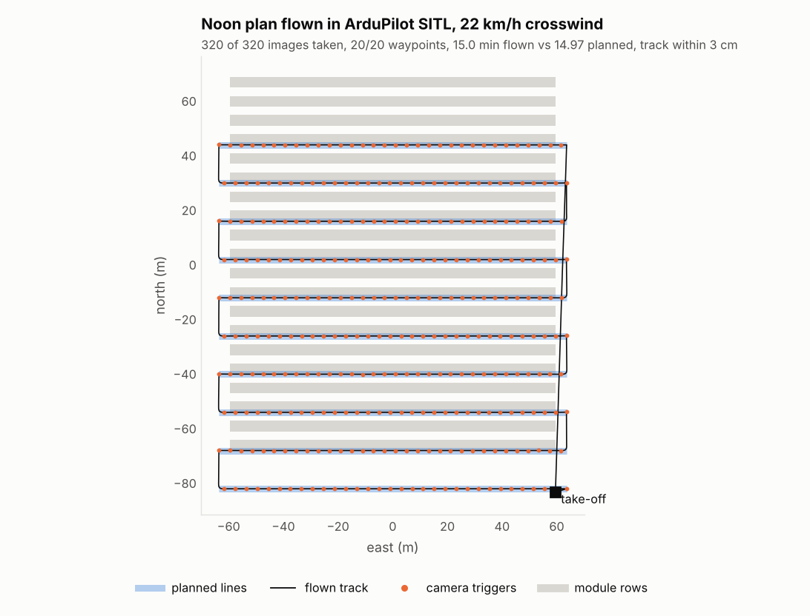

# pv-drone-inspection-planner

**Drone thermography of solar farms, planned around the physics.** For each inspection it works
out:

- **when** the images will be valid (enough sunlight on the modules, low wind);
- **where** to put the camera so every cell is resolved and the sun's reflection off the glass
  stays out of the images;
- **how** to split the flight across batteries.

The result is exported as ArduPilot / QGroundControl missions, and flown and checked in
ArduPilot's simulator.

[](https://github.com/Mohammedgmail/pv-drone-inspection-planner/actions/workflows/ci.yml)
[](https://github.com/Mohammedgmail/pv-drone-inspection-planner/actions/workflows/sitl.yml)




## Why

Thermal images from a drone find faulty PV modules: hot cells, failed bypass diodes, dead
strings. But a thermal image is only trustworthy under certain conditions. IEC TS 62446-3 (as
cited by IEA PVPS and industry guides) asks for:

- at least 600 W/m² of irradiance on the module plane;
- wind below 28 km/h;
- a resolution of at least 3 cm per pixel on the module.

The module glass also behaves like a mirror. A reflection of the sun in a thermal image looks
like a hot spot, or hides a real one.

General survey planners fly a fixed lawnmower pattern at one height with the camera pointing
straight down. That ignores all of the above. This planner treats each pass over the rows as a
small optimisation problem, solved for the sun position at the time that pass will actually be
flown.

## What it does

1. **Valid window.** Irradiance on the module plane comes from a pvlib clear-sky model, or from a
   live Open-Meteo forecast that also supplies wind. The planner keeps the periods with at least
   600 W/m² and wind within the limit.
2. **Camera placement for every pass.** The drone flies parallel to the rows, with the camera
   aimed at their centre and the long side of the image along the row. The planner searches
   height and sideways offset. A placement counts as valid only if every sample point on the
   covered modules meets all of these:
   - the resolution on the module surface is 3 cm/px or finer;
   - the viewing angle is between 5° and 60° from the module normal;
   - the sun's mirror reflection is at least 15° from the line of sight;
   - the point is inside the image and not hidden by another row.

   The planner then picks the fastest valid placement, where speed is limited by motion blur.
3. **Rows per pass.** One, two or three rows per pass, whichever finishes soonest. In the example
   plant, two rows fit in the image and three do not.
4. **Batteries and timing.** Passes are packed into battery sorties with a reserve. Take-off,
   climb, S-curve accelerations and the return-home landing all use ArduCopter's defaults.
5. **Export:**
   - ArduPilot `.waypoints` and QGroundControl `.plan` files, one per battery;
   - a GeoJSON map;
   - a readable report;
   - `mission.json` with the predicted pose of every image, which is the hand-off to defect
     mapping.

## Findings

The example site is a 2.3 MWp fixed-tilt plant in Northumberland, UK, at 55° N: 20 rows of
120 m, 4,200 modules at 30° tilt facing south. Its config is
[`examples/northumberland.yaml`](examples/northumberland.yaml). The camera is a DJI Zenmuse H20T
thermal (640×512, 12 µm pixels, 13.5 mm lens). All results below are for clear-sky conditions on
21 June unless stated.

- **The whole plant takes one battery:**
  - 12 minutes in the morning;
  - 15 minutes around solar noon;
  - 10 passes covering two rows each, with 260–320 images.
- **The best camera placement changes through the day:**
  - at 09:30 it is 30 m up, 7 m in front of the rows, camera at −76°;
  - at 13:00 it is 15 m up, 19.5 m in front, camera at −34°, with the drone flying sideways and
    facing the modules.
- **Keeping the morning placement at noon would ruin the images.** Between 12:40 and 13:40, the
  sun's reflection comes within 4–5° of the line of sight on the worst image. The re-planned
  placement keeps it 15° or more away all day. The cost is 25% more flight time around noon,
  because the passes are lower and slower.
- **The inspection season is short this far north.** On a clear day, irradiance on the modules
  stays above 600 W/m² for up to 7.3 hours in June. From November to January it hardly gets
  there at all: at most 0.4 hours in early November, none in December, and at most 1.4 hours
  at the end of January. Seville, at 37° N, has 5–7 hours every month.





| 21 June | Take-off | Height | Offset | Gimbal | Speed | Flight time | Worst glare margin |
|---|---|--:|--:|--:|--:|--:|--:|
| Morning plan | 09:32 | 30.5 m | +7.0 m | −76° | 2.5 m/s | 12.0 min | 43° |
| Noon plan | 13:00 | 15.0 m | +19.5 m | −34° | 1.8 m/s | 15.0 min | 16° |

Offset is the horizontal distance from the centre of the two rows, measured towards the side the
modules face. Speed is the fastest that keeps motion blur within one pixel, assuming a typical
10 ms microbolometer time constant.

## Checked in ArduPilot's simulator

I flew the noon mission in ArduCopter 4.7.2 software-in-the-loop (SITL) using
[`sitl/fly_sitl.py`](sitl/fly_sitl.py): once in calm air, and once in a 22 km/h crosswind with
turbulence.

| | Calm | 22 km/h crosswind + turbulence |
|---|--:|--:|
| Waypoints visited | 20 / 20 | 20 / 20 |
| Images triggered by the autopilot, planned 320 | 320 | 320 |
| Modules with an image within half a spacing of them | 100% | 100% |
| Flight time, planned 14.97 min | 14.98 min | 15.00 min |
| Heading error on the passes, 95th percentile | 0.02° | 0.2° |
| Distance from the planned line, 95th percentile | 3 cm | 3 cm |

The drone flies each pass sideways, keeping the heading the planner chose. It does that with a
`CONDITION_YAW` command and `WP_YAW_BEHAVIOR=0`, and SITL confirms the heading holds. The flight
times agree because the planner uses ArduCopter's own acceleration, jerk, climb, descent and
landing settings. An early version of the planner ignored them and came out 8% short. A separate
[GitHub Actions workflow](.github/workflows/sitl.yml) builds SITL and repeats the crosswind
flight on every push.



## Quick start

This works on macOS, Linux and Windows with Python 3.10–3.13. On a Mac, run
`brew install python@3.12` first if `python3 --version` shows 3.9.

```bash
git clone https://github.com/Mohammedgmail/pv-drone-inspection-planner.git
cd pv-drone-inspection-planner
python3.12 -m venv .venv && source .venv/bin/activate
pip install -e ".[dev]"
pytest                                          # 38 tests, about 10 s

python -m pvmission plan examples/northumberland.yaml --date 2026-06-21 --start 13:00 --out mission
python -m pvmission season examples/northumberland.yaml      # valid hours per month
python -m pvmission plan examples/northumberland.yaml --forecast --out mission   # live weather
```

`mission/` then contains:

| File | What it is |
|---|---|
| `report.md` | Window, sorties, and a table of every pass (height, offset, gimbal, heading, speed, images, glare margin) |
| `sortie1.plan` | QGroundControl plan (ArduPilot); open it via *Plan → Open* |
| `sortie1.waypoints` | The same mission as a QGC WPL 110 file for Mission Planner, MAVProxy or pymavlink |
| `plan.geojson` | Rows, passes and take-off point; GitHub draws it as a map (see [the example](examples/june-noon/plan.geojson)) |
| `mission.json` | Plant layout with module IDs, camera, constraints, and the predicted pose of every image |
| `recommended.parm` | `WP_YAW_BEHAVIOR 0`, needed so ArduPilot keeps the heading on each pass |

To plan your own site, copy `examples/northumberland.yaml` and change the location, layout,
take-off point, drone and requirements.

To fly a plan in SITL yourself, you need Linux or WSL and an ArduPilot checkout with
`./waf configure --board sitl && ./waf copter`. The steps in
[`sitl.yml`](.github/workflows/sitl.yml) do this in about 5 minutes. Then run:

```bash
pip install -e ".[sitl]"
python sitl/fly_sitl.py --ardupilot ~/ardupilot --mission mission --wind 6 --wind-dir 0 --turbulence 1
```

## Method notes

- **Geometry.** Each table is a tilted rectangle in a local east-north-up frame, converted to
  latitude and longitude on the WGS84 ellipsoid. The tests check that conversion against exact
  geodesics to within 5 cm over 700 m.
- **Sample points.** For a pass, the samples are the lower edge, middle and upper edge of every
  covered row. Each is taken at the image centre and half an image spacing either side, the
  furthest any module can be from its best image. The tests re-derive every constraint for 400
  random points per case, using only the exported gimbal pitch and heading.
- **Resolution on the module.** Pixel footprint is slant range × pixel pitch / focal length,
  divided by the cosine of the viewing angle. This is the conservative direction.
- **Glare.** The reflection direction is r = 2(n·s)n − s, from the module normal n and the sun
  vector s. It is ignored when the sun is behind the modules. The 15° margin is a design choice,
  not a number from the standard; set `min_glare_deg` to change it.
- **Line ends.** Each pass extends half an image spacing past the rows, plus ArduCopter's 2 m
  waypoint radius. Triggering stops when the end waypoint counts as reached, and this margin is
  why the autopilot's 320 images match the plan exactly.

## Limitations

- **Layouts and terrain.** It handles regular fixed-tilt layouts on flat ground. It does not yet
  handle trackers, irregular blocks or terrain.
- **The standard's thresholds are secondary-source.** The 600 W/m², 28 km/h and 3 cm/px limits
  are IEC TS 62446-3 as quoted by IEA PVPS and an industry guide. I have not checked them against
  the standard's own text, and this tool does not certify compliance. It also models only the
  sun's specular reflection, not reflections of the sky or of nearby objects.
- **Real drones will differ from the timing.** Flight time uses ArduCopter's default motion
  settings, and endurance is a time budget with no wind-dependent energy model.
- **The mission files are for ArduPilot.** The camera preset is DJI's H20T optics, but DJI
  aircraft do not fly MAVLink missions. They use DJI's own WPML format, which is not exported
  yet. Any thermal camera can be configured instead. SITL accepted the gimbal commands, but had
  no simulated gimbal attached.
- **The live forecast is not tested here.** The forecast parser is tested with payloads shaped
  like Open-Meteo's. The live API call runs only in an informational CI job.

## Roadmap

- [ ] **Companion repo, `pv-thermal-defect-mapper`:** detect hot spots in the thermal images and
      use `mission.json` (image poses plus plant layout) to name the exact module behind each
      defect, giving a defect map and report
- [ ] DJI WPML (KMZ) export for Matrice-series aircraft
- [ ] Layouts from GeoJSON or OpenStreetMap, single-axis trackers, terrain following
- [ ] Wind-aware battery model and multi-drone missions

## Project layout

```
src/pvmission/
  plant.py      # plant layout, module IDs, WGS84 local frame
  camera.py     # thermal camera model and presets
  sun.py        # sun position, plane-of-array irradiance, valid windows, Open-Meteo
  geometry.py   # placement search: resolution, viewing angle, glare, field of view, occlusion
  planner.py    # passes, rows per pass, batteries, ArduCopter timing model
  export.py     # ArduPilot waypoints, QGroundControl plan, GeoJSON, mission.json, report
  config.py     # site YAML
  __main__.py   # command line: plan / season
sitl/           # fly a plan in ArduPilot SITL and compare with the plan
examples/       # example site and its noon mission
docs/           # figures, the script that draws them, SITL results
tests/          # pytest suite
```

## Credits

- [pvlib python](https://github.com/pvlib/pvlib-python) for solar position, clear-sky and
  plane-of-array irradiance (K. S. Anderson et al., *JOSS* 8(92), 5994, 2023).
- [ArduPilot](https://ardupilot.org) (GPLv3) SITL and
  [pymavlink](https://github.com/ArduPilot/pymavlink) (LGPLv3), used for testing and not included
  here.
- The inspection conditions are IEC TS 62446-3 as cited in S. Spataru,
  [*Framing drone IRT conditions*](https://iea-pvps.org/wp-content/uploads/2025/08/07_S.-Spataru_Framing-Drone-IRT-Conditions.pdf)
  (IEA PVPS Task 13, 2025) and by
  [Sitemark](https://www.sitemark.com/blog/is-sitemark-iec-compliant/).
- Camera data comes from DJI's
  [Zenmuse H20 series specifications](https://enterprise.dji.com/zenmuse-h20-series/specs).
- The weather forecast is from [Open-Meteo.com](https://open-meteo.com) (CC BY 4.0).
- The irradiance modelling follows the same approach as my
  [pv-power-forecasting](https://github.com/Mohammedgmail/pv-power-forecasting) repo.

## Author

**Mohammed Alfandi** · MSc Robotics & AI, Newcastle University ·
[LinkedIn](https://linkedin.com/in/mohammed-alfandi/) · [ResearchGate](https://researchgate.net/profile/Mohammed-Alfandi/)

Released under the [MIT License](LICENSE).
